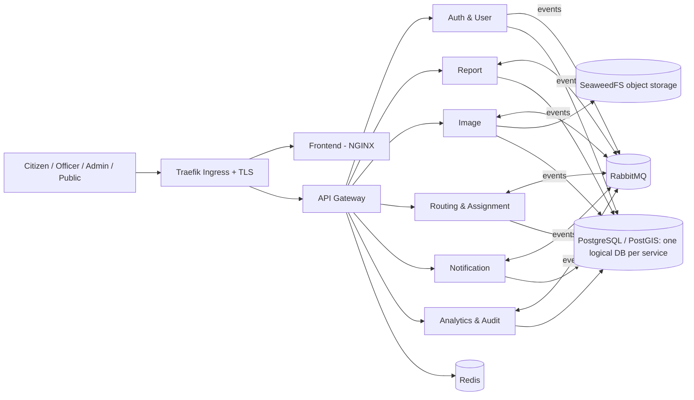

# Civic Issue Tracker: Project Overview and Index

> **Status:** Approved design baseline
> **Last updated:** 2026-10-09
> **Owner:** Gautam (solo developer)
> **Read this first.** It explains the project, the rules for using these documents, and where every decision lives.

---

## 1. Project summary

The **Civic Issue Tracker** is a web platform where citizens report local problems (potholes, garbage, broken streetlights) by uploading a photo and a location. Each report is processed, routed to the relevant department or ward, and tracked through statuses until it is resolved and closed. Officials use an admin dashboard, and the public can see a view of open issues.

It is built as a set of **microservices** and is assessed on how well it applies DevOps technologies.

## 2. Assessment (20 marks)

| Area | Marks | What is assessed | Where it is designed |
|---|---|---|---|
| Docker | 4 | Every service containerized | `05` |
| Microservices | 3 | Sound service-based architecture | `03`, `04` |
| CI/CD pipeline | 3 | Automated testing, building and deployment | `08` |
| Infrastructure as Code | 2 | Environment provisioned with Terraform | `07` |
| Kubernetes | 2 | Orchestration and scaling of services | `06` |
| DevSecOps | 2 | Image, dependency and secret scanning in the pipeline | `09` |
| Cloud provider or local machine | 2 | The hosting environment | `10` |
| Publicly accessible link | 2 | Live project on a real URL anyone can open | `10` |

## 3. Constraints and context

- **Team:** one person. **Timeline:** no fixed deadline ("we go as we go").
- **Cost rule:** everything stays within **free-tier resources**. Paid resources are a **last resort**.
- **Live requirement:** the public link must stay up for about **one month** after the project is complete, with **at most roughly 100 requests** in that time (testing during development does not count).
- **Data:** all data is **synthetic** (including wards). No real ward data is used.
- **Tooling:** Claude (in a Claude Project) is used for design and for writing prompts. **Antigravity** is used for coding. **Git** is the VCS and **GitHub** (public repo) is the SCM.
- **Design principle:** follow proper, good **System Design** throughout.

## 4. Architecture at a glance

**Services (8):** API Gateway, Auth & User, Report, Image, Routing & Assignment, Notification, Analytics & Audit, Frontend.
**Infrastructure:** PostgreSQL + PostGIS, RabbitMQ, Redis, SeaweedFS, Mailpit (dev email).
**Platform:** Docker, k3s (single-VM Kubernetes), Terraform, GitHub Actions, GCP (credit-funded), GHCR.

## 5. Document map

| # | File | Contents |
|---|---|---|
| 00 | `00-index-and-overview.md` | This file |
| 01 | `01-functional-requirements.md` | Requirements with IDs and tiers |
| 02 | `02-non-functional-requirements.md` | Targets and tiers |
| 03 | `03-architecture-and-communication.md` | Services, data ownership, events, main flow |
| 04 | `04-tech-stack-and-data-stores.md` | Languages, frameworks, databases, broker, storage |
| 05 | `05-docker-and-service-standards.md` | Repo layout, Dockerfile rules, registry, Compose parity |
| 06 | `06-kubernetes-design.md` | k3s, namespaces, workloads, ingress, security |
| 07 | `07-infrastructure-as-code.md` | Terraform design, state, access, apply policy |
| 08 | `08-cicd-pipeline.md` | Workflows, deploy path, branching, versioning |
| 09 | `09-devsecops.md` | Scanners, thresholds, signing, supply-chain rules |
| 10 | `10-hosting-and-cost.md` | Cloud plan, credits, fallbacks, guardrails |
| 11 | `11-scope-and-phases.md` | Phases, cut order, risks, demo, definition of done |
| 12 | `12-decision-log.md` | Every decision and change of direction, with reasons |
| , | `PROJECT-INSTRUCTIONS.md` | Instructions for the Claude Project, workflow, prompt template |
| , | `PROGRESS.md` | Running progress tracker |
| · | `AGENT-RULES.md` | Standing rules for Antigravity prompts |

## 6. Rules for using these documents

1. **The documents are the source of truth.** If a chat, a prompt or a code suggestion conflicts with them, stop and raise it before acting.
2. **Changes go through the decision log.** Any change of direction needs a new entry in `12-decision-log.md` and an edit to the affected document(s).
3. **Requirement IDs** (for example `RPT-01`, `SEC-06`) identify requirements. Use them in prompts, commits and tests.
4. **Tiers:** **[Core]** = must build. **[Should]** = in scope, build after Core. **[Optional]** = kept open for later if the need arises. **Core and Should are in scope.**
5. **Deferred decisions:** each document ends with a "Deferred decisions" section. These were intentionally left open and are settled in the named phase, then recorded here.
6. **Volatile facts** (free-tier limits, tool status) carry a "verified" date. Re-check them before relying on them, above all before cloud sign-up.

## 7. Glossary

| Term | Meaning |
|---|---|
| **k3s** | Lightweight, fully conforming Kubernetes distribution, used on a single VM |
| **HPA** | Horizontal Pod Autoscaler, scales replicas on CPU |
| **IAP** | Identity-Aware Proxy, Google's tunnel for SSH without a public port |
| **OIDC / Workload Identity Federation** | Keyless authentication from GitHub Actions to GCP |
| **GHCR** | GitHub Container Registry |
| **SBOM** | Software bill of materials listing an image's contents |
| **Outbox pattern** | Writing an event to a table in the same transaction as the data, then publishing it, so neither is lost |
| **DLQ** | Dead-letter queue for messages that keep failing |
| **Choreography** | Services react to each other's events without a central coordinator |
| **Sealed Secrets** | Encrypted Kubernetes secrets that are safe to store in Git |
| **Ward** | A city administrative area used for routing (synthetic in this project) |
| **SLA** | Target time to resolve a report, used for escalation |
| **Walking skeleton** | A thin end-to-end path built first, then widened |
